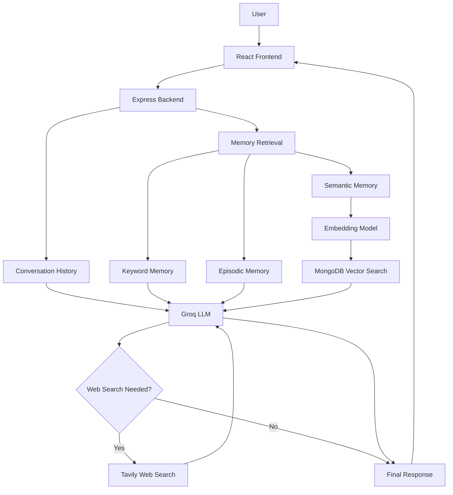

# RecallAI 🧠

### An AI Chat Agent That Remembers What You Asked and When.

RecallAI is an intelligent personal AI assistant that combines conversational AI, web search, and persistent memory. Unlike traditional chatbots that primarily focus on the current conversation, RecallAI can retrieve relevant information from previous conversations, understand questions through semantic similarity, and recall when specific topics were discussed.

It is designed to provide fast, context-aware, and reliable responses while maintaining continuity across conversations.

---

## ✨ Key Features

### 🧠 Multi-Layer Memory System

RecallAI uses multiple memory mechanisms to maintain conversational context and retrieve historical information.

- **Short-Term Memory:** Maintains context from recent messages in the current conversation.
- **Long-Term Keyword Memory:** Retrieves relevant information from previous conversations using keyword matching.
- **Semantic Memory:** Uses vector embeddings to retrieve relevant past conversations based on meaning rather than exact keyword matches.
- **Episodic Memory:** Retrieves previous questions and discussions based on time, including today, yesterday, last week, and the first question.

### 🌐 Web Search

- Integrated web search using Tavily.
- Uses an LLM tool-calling mechanism to decide when external information is needed.
- Retrieves current information from the web.
- Includes source URLs in responses when available.

### ⚡ Fast AI Responses

- Powered by Groq inference.
- Uses a compact conversation history to control token consumption.
- Limits retrieved memory context to improve response efficiency.
- Reuses the embedding model instead of loading it for every request.

### 💾 Persistent Conversation History

- Stores conversations in MongoDB Atlas.
- Maintains message roles and timestamps.
- Supports retrieving previous conversations.

---

## 🏗️ Technology Stack

| Layer | Technology |
|---|---|
| Frontend | React.js, Vite |
| Backend | Node.js, Express.js |
| Database | MongoDB Atlas |
| ODM | Mongoose |
| LLM Provider | Groq |
| LLM Model | openai/gpt-oss-120b |
| Embedding Framework | Hugging Face Transformers.js |
| Embedding Model | all-MiniLM-L6-v2 ONNX |
| Vector Search | MongoDB Atlas Vector Search |
| Web Search | Tavily API |

---

## 🧩 System Architecture



---

## 🧠 How Memory Works

### 1. Short-Term Memory

Recent messages from the active conversation are retrieved and passed to the LLM to maintain conversational continuity.

### 2. Long-Term Keyword Memory

RecallAI searches historical user messages using extracted keywords and retrieves matching information from previous conversations.

### 3. Semantic Memory

RecallAI uses the `all-MiniLM-L6-v2` embedding model to convert text into 384-dimensional numerical vectors.

The semantic retrieval pipeline:

1. A user sends a new question.
2. The embedding model converts the question into a vector.
3. MongoDB Atlas Vector Search compares it with stored message embeddings.
4. Relevant historical messages are retrieved using vector similarity.
5. The retrieved memories are passed to Groq as additional context.

This makes it possible to retrieve relevant conversations even when the user phrases a question differently from the original discussion.

### 4. Episodic Memory

Episodic memory focuses on historical events and timestamps.

It supports queries such as:

- What was my first question?
- What did I ask yesterday?
- What did we discuss today?
- What did I discuss last week?
- When did I mention a particular topic?

Timestamps are formatted using the Asia/Kolkata timezone.

---

## 📁 Project Structure

```text
RecallAI/
│
├── client/
│   └── src/
│       ├── components/
│       ├── App.jsx
│       ├── api.js
│       └── main.jsx
│
├── server/
│   ├── models/
│   │   ├── Conversation.js
│   │   └── Memory.js
│   │
│   ├── routes/
│   │   └── chat.js
│   │
│   ├── services/
│   │   ├── memory.js
│   │   ├── groq.js
│   │   └── webSearch.js
│   │
│   ├── server.js
│   └── .env
│
├── design.md
├── README.md
└── .gitignore
```

---

## ⚙️ Getting Started

### Prerequisites

Make sure you have:

- Node.js and npm installed.
- MongoDB Atlas account.
- Groq API key.
- Tavily API key.
- Git installed.

### 1. Clone the Repository

```bash
git clone YOUR_GITHUB_REPOSITORY_URL
cd RecallAI
```

### 2. Backend Setup

```bash
cd server
npm install
```

Create a `.env` file inside the `server` directory:

```env
PORT=8000
MONGO_URI=your_mongodb_connection_string
GROQ_API_KEY=your_groq_api_key
TAVILY_API_KEY=your_tavily_api_key 
```

Start the backend using the development script configured in your `server/package.json`:

```bash
npm run dev
```

### 3. Frontend Setup

Open another terminal:

```bash
cd client
npm install
```

Configure the backend URL in your frontend environment if your API client uses `VITE_BACKEND_URL`:

```env
VITE_BACKEND_URL=http://localhost:8000/api
```

Start the frontend using the development script configured in your `client/package.json`:

```bash
npm run dev
```

### 4. Configure MongoDB Atlas Vector Search

Create a Vector Search index on the `memories` collection.

Index name:

```text
memory_vector_index
```

Index definition:

```json
{
  "fields": [
    {
      "type": "vector",
      "path": "embedding",
      "numDimensions": 384,
      "similarity": "cosine"
    },
    {
      "type": "filter",
      "path": "role"
    }
  ]
}
```

Wait until the index status becomes `READY`.

The embedding model is downloaded when first initialized, so the first embedding request may take longer.

---

## 🔌 API Endpoints

Base URL:

```text
http://localhost:8000/api/chat
```

| Method | Endpoint | Description |
|---|---|---|
| GET | `/conversations` | Retrieve all conversations |
| GET | `/:conversationId` | Retrieve a specific conversation |
| POST | `/` | Send a message and receive an AI response |

### Example Request

```json
{
  "message": "What technologies am I using for RecallAI?",
  "conversationId": null
}
```

### Example Response

```json
{
  "answer": "You are building RecallAI using React, Node.js, MongoDB, and Groq.",
  "conversationId": "your_conversation_id",
  "memoriesUsed": 1,
  "episodicMemoriesUsed": 0,
  "semanticMemoriesUsed": 2
}
```

The response counts represent retrieved memory records, not a guarantee that every retrieved record was used in the final answer.

---

## 🔐 Environment Variables & Security

Never commit API keys or database credentials.

Keep the following in your `.gitignore`:

```gitignore
node_modules/
.env
.env.*
!.env.example
dist/
.DS_Store
```

Create `.env.example` files containing placeholder values instead of actual secrets.

---

## 🚀 Future Improvements

- Advanced memory ranking and relevance optimization.
- Automatic user profile and fact extraction.
- Memory summarization and consolidation.
- Improved natural-language date interpretation.
- Streaming AI responses.
- Automated retrieval evaluation.
- Better memory deduplication.
- More robust monitoring and error handling.

---

## 📖 Documentation

For the detailed architecture, memory design, retrieval pipeline, and technical decisions, see:

- [System Design](./design.md)

---

## 👨‍💻 Author

Developed as an AI-powered personal memory assistant project.

**RecallAI — Because your AI should remember, not just respond.**